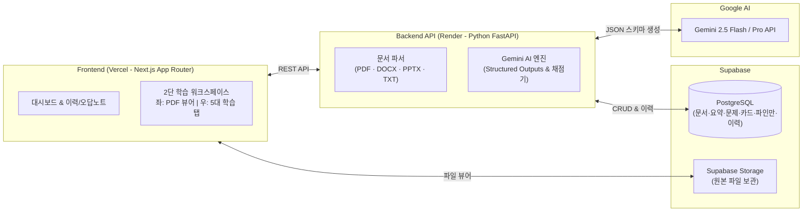

# 의대생 학습 포털 (MedStudy Portal) 통합 구현 계획서 — Tikonote 벤치마킹 반영

본 계획서는 요청하신 기본 요구사항(0~5번)에 더해, 의대생들이 많이 활용하는 **Tikonote(티코노트)**의 능동적 인출(Active Recall) 및 시각화 학습 기능을 결합한 전체 구현 계획입니다.

---

## 1. Tikonote 핵심 기능 분석 및 포털 통합 매핑

| Tikonote 기능 | 기능 설명 | MedStudy Portal 구현 방안 |
| :--- | :--- | :--- |
| **1. AI 노트 메이커** | PDF·PPTX·오디오·유튜브 링크를 코넬 노트/구조화 요약으로 변환 | **자료 요약 & 의학용어 해설**: 병태생리·임상양상·진단·치료 중심 구조화 요약 + 전문 의학용어 쉬운 비유 해설 + **원본 페이지 근거 링크** |
| **2. AI 퀴즈 & 테스트** | 학습 자료 기반 객관식·모의고사 자동 출제 및 취약점 진단 | **예상문제 (4지선다·서술형)**: 난이도별 출제, 답 선택 즉시 **정오답·오답 선지 분석·상세 해설·원본 근거 페이지** 표시 |
| **3. 자동 플래시카드 (Smartcards)** | Anki 대안으로 핵심 개념을 암기카드로 생성 및 간격 반복 | **AI 플래시카드**: 앞면(질문/용어) ↔ 뒷면(정답/기전) 카드 자동 생성 및 `다시 / 어려움 / 알맞음 / 쉬움` 숙련도 기반 복습 스케줄링 |
| **4. AI 마인드맵 (Mind Maps)** | 복잡한 대사·해부학 경로와 텍스트를 시각 다이어그램으로 변환 | **AI 마인드맵 뷰어**: 병태생리 기전, 약물 작용기전(MOA), 감별진단 계통도를 **Mermaid 다이어그램**으로 자동 생성 및 시각화 |
| **5. 파인만 AI 튜터 (Feynman AI)** | 사용자가 개념을 설명하면 AI가 이해도 점수와 빈틈을 피드백 | **파인만 & 블러팅(Blurting) 튜터**: 힌트 없이 백지에 배운 내용을 자유 서술하면 AI가 원본과 대조해 **이해도 점수·누락 기전·오개념** 교정 리포트 제공 |
| **6. 블러팅(Blurt) 기법** | 단서 없이 아는 내용을 모두 적어보며 능동적 인출 훈련 | 파인만 튜터 내 **타이머·백지 인출 모드**로 통합 제공 |

---

## 2. 시스템 아키텍처 (Vercel + Render + Supabase + Gemini API)



> **Gemini API 활용 방식**: 웹 시스템 백엔드 연동을 위해 Google AI Studio의 **Gemini API 키**(`gemini-2.5-flash` 기본)를 사용하며, 무료 티어 활용 및 포털 내 사용자 본인 키 입력(BYOK) 옵션을 지원합니다.

---

## 3. UI/UX 화면 구성 (5대 학습 스튜디오 탭)

학습 페이지(`/study/[docId]`)는 좌측에 원본 문서, 우측에 Tikonote 스타일의 5개 학습 탭을 배치합니다.

```text
+-----------------------------------------------------------------------------------+
| MedStudy Portal       [대시보드]   [자료 업로드]   [이력/오답노트]   [API 키 설정] |
+------------------------------------+----------------------------------------------+
|  📄 원본 자료 뷰어 (좌측 45%)        |  🧠 AI 학습 스튜디오 (우측 55%)               |
|                                    |  [요약·용어] [마인드맵] [예상문제] [카드] [파인만] |
|  - PDF 페이지 탐색 및 확대/축소      |----------------------------------------------|
|  - 우측에서 [근거: p.14] 클릭 시     |  1. 요약·용어: 핵심 요약 + 용어 툴팁 + 근거  |
|    해당 페이지로 즉시 스크롤 이동    |  2. 마인드맵: Mermaid 기전/계통도 렌더링      |
|  - 인용 원문 구절 하이라이트 표시    |  3. 예상문제: 4지선다/서술형 & 즉시 해설     |
|                                    |  4. 카드: 앞/뒷면 플립 & 4단계 숙련도 체크   |
|                                    |  5. 파인만: 백지 블러팅 서술 & AI 빈틈 진단  |
+------------------------------------+----------------------------------------------+
```

---

## 4. 데이터베이스 스키마 요약 (Supabase PostgreSQL)

1. `documents`: 업로드 자료 메타데이터 및 페이지별 추출 텍스트(`page_contents` JSONB)
2. `summaries`: 핵심 개요, 섹션별 요약+근거(`key_points`), 의학용어 해설(`medical_terms`), AI 마인드맵(`mindmap_mermaid`)
3. `quizzes` & `quiz_questions`: 4지선다(`MCQ`)·서술형(`ESSAY`) 문항, 정답/모범답안, 채점 키워드, 상세 해설, 근거 위치
4. `quiz_attempts`: 문제 풀이 이력 및 문항별 정오답 기록
5. `flashcards`: 앞/뒷면 암기카드, 숙련도(`again | hard | good | easy`), 다음 복습 일시(`next_review_at`)
6. `feynman_sessions`: 블러팅 주제, 사용자 서술 내용, AI 평가 리포트(`understanding_score`, `missing_concepts`, `misconceptions`)

---

## 5. 단계별 구현 로드맵 및 현재 진행 현황

* **Phase 1: DB 스키마 & 백엔드 기반 구축** *(완료)*
  * `supabase/schema.sql`, `backend/requirements.txt`, `backend/render.yaml`
  * `document_parser.py` (PDF/DOCX/PPTX/TXT 파싱), `models.py` (전체 스키마), `supabase_service.py` (Supabase + 로컬 폴백)
* **Phase 2: Gemini AI 엔진 & FastAPI 라우터 완성** *(다음 단계)*
  * `gemini_service.py`: 요약·용어·마인드맵 생성, 4지선다/서술형 출제 및 서술형 채점, 플래시카드 생성, 파인만/블러팅 평가
  * `routers/`: `documents.py`, `study.py`, `history.py` 및 `main.py`
* **Phase 3: Next.js 프론트엔드 기본 및 자료 업로드/뷰어 구축**
  * Next.js App Router + Tailwind CSS 세팅
  * 대시보드(`/`), 자료 첨부(`/upload`), 좌측 PDF 페이지 점프 뷰어(`PdfViewer`)
* **Phase 4: 5대 학습 스튜디오 탭 구현**
  * `SummaryTab`(요약·용어 툴팁·근거 딥링크), `MindmapTab`(Mermaid 렌더링), `QuizTab`(4지선다·서술형 즉시 해설), `FlashcardTab`(카드 플립·간격 반복), `FeynmanTab`(블러팅 백지 인출·AI 피드백)
* **Phase 5: 통합 이력/오답노트(`/history`) 및 통합 검증**
  * 틀린 문제 다시 풀기, 복습 필요 카드 필터링, 백엔드/프론트엔드 빌드 및 동작 테스트

